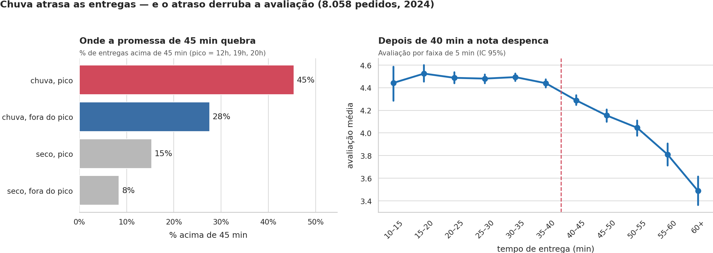

# Chuva atrasa as entregas e o atraso derruba a avaliação — diagnóstico 2024 do app de delivery

Em 2024, 18,4% das entregas passaram de 45 min; com chuva a entrega típica leva 9 min a mais e, depois de 40 min, a avaliação despenca. O cupom está associado a ~3× mais clientes novos, mesmo fora da campanha de julho.



## 1. Pergunta de negócio
A diretoria pediu um diagnóstico de 2024 em três frentes: **operação** (quando os pedidos acontecem e o que atrasa a entrega), **clientes** (quanto gastam e o que derruba a avaliação) e **alavancas** (cupons e chuva).

## 2. Dados
- **Fonte:** `dados/delivery_pedidos.csv`, base fornecida no módulo DS-PY-018 (CAIXAVERSO / Ada Tech).
- **Período:** 01/01/2024 a 31/12/2024 · São Paulo, Rio de Janeiro e Belo Horizonte.
- **Tamanho:** 8058 × 18 (original) → 8058 × 23 (limpa). Nenhum pedido removido.
- **Unidade de observação:** um pedido.

### Dicionário da base limpa (`saidas/delivery_pedidos_limpo.csv`)
| Coluna | Tipo | Exemplo | % faltantes | Descrição |
|---|---|---|---|---|
| pedido_id | object | 500000 | 0.0 | identificador do pedido |
| data_hora | datetime64[ns] | 2024-01-01 11:21:00 | 0.0 | data e hora do pedido |
| cidade | object | São Paulo | 0.0 | cidade padronizada (3 valores) |
| bairro | object | Tatuapé | 0.0 | bairro de entrega |
| restaurante_id | object | R912 | 0.0 | identificador do restaurante |
| tipo_cozinha | object | Hambúrguer | 0.0 | tipo de cozinha |
| plataforma | object | Android | 0.0 | Android, iOS, Web ou Não informada |
| forma_pagamento | object | Pix | 0.0 | forma padronizada (4 valores) |
| cupom | bool | False | 0.0 | usou cupom |
| cliente_novo | bool | False | 0.0 | primeiro pedido do cliente |
| chuva | bool | False | 0.0 | choveu na cidade no dia |
| distancia_km | float64 | 2.68 | 4.0 | distância restaurante → cliente |
| tempo_entrega_min | float64 | 28.0 | 0.41 | minutos até a entrega |
| valor_pedido | float64 | 44.02 | 0.0 | valor dos itens em R$ (sem taxa) |
| taxa_entrega | float64 | 7.4 | 0.0 | taxa de entrega em R$ |
| avaliacao | float64 | 4.0 | 16.65 | nota 1 a 5 (opcional) |
| data | datetime64[ns] | 2024-01-01 00:00:00 | 0.0 | dia do pedido |
| mes | int32 | 1 | 0.0 | mês (1–12) |
| hora | int32 | 11 | 0.0 | hora (0–23) |
| dia_semana | category | Seg | 0.0 | Seg…Dom |
| tempo_invalido | bool | False | 0.0 | True = tempo era 999 ou negativo (virou NaN) |
| distancia_invalida | bool | False | 0.0 | True = distância > 25 km (virou NaN) |
| pedido_grande | bool | False | 0.0 | True = valor ≥ 5× a mediana da cozinha (mantido) |

## 3. Como rodar
Pré-requisitos: **Python 3.10 ou superior** e **Git** instalados.

```bash
# 1. Baixar o projeto
git clone https://github.com/flavianemarra03/Flaviane-Cristina-Pereira-marra-.git
cd Flaviane-Cristina-Pereira-marra-

# 2. (opcional, recomendado) criar um ambiente virtual
python -m venv .venv
.venv\Scripts\activate          # Windows
# source .venv/bin/activate      # Linux / Mac

# 3. Instalar as bibliotecas
pip install -r requirements.txt

# 4. Abrir o notebook
jupyter notebook projeto_final.ipynb
```
- A base original já está em `dados/delivery_pedidos.csv` — **não precisa baixar nada à parte**.
- No Jupyter, use **Kernel → Restart & Run All**. No **VS Code**: abra a pasta do projeto, abra `projeto_final.ipynb`, escolha o kernel Python e clique em **Executar Tudo**.
- Ao final, a pasta `saidas/` é gerada de novo (base limpa, dicionário e figura principal).
- Tempo de execução: cerca de 1 minuto.

## 4. Estrutura do repositório
```
Flaviane-Cristina-Pereira-marra-/
├── README.md                 ← este arquivo
├── requirements.txt          ← bibliotecas
├── projeto_final.ipynb       ← análise completa (Etapas 1 a 11), já executado
├── apresentacao_roteiro.md   ← roteiro da apresentação de 7 min
├── dados/
│   └── delivery_pedidos.csv  ← base original (não alterada)
└── saidas/
    ├── delivery_pedidos_limpo.csv
    ├── dicionario_dados.csv
    └── figura_principal.png
```

## 5. Metodologia e decisões de limpeza
- **720 linhas** vieram com o pedido inteiro numa só coluna (o valor "R$ 44,02" tinha vírgula) → re-lidas com o leitor de CSV e devolvidas às colunas. Nenhum pedido perdido.
- Cidade (13 grafias → 3) e pagamento (8 grafias → 4) padronizados pelo texto normalizado.
- `valor_pedido` em texto com R$ convertido sem perda; `cupom`, `cliente_novo` e `chuva` viraram booleanos.
- Tempo 999/negativo e distâncias acima de 25 km → NaN com flag; **nenhuma linha removida**.
- 24 pedidos corporativos mantidos com flag `pedido_grande`; ticket típico = **mediana**.
- Testes não paramétricos (Mann-Whitney, Kruskal-Wallis, Spearman) porque as variáveis são assimétricas; sempre com tamanho de efeito.

## 6. Hipóteses (α = 5%) — resposta sim/não
| Hipótese | Teste | p-valor | Efeito | Resposta |
|---|---|---|---|---|
| H1 chuva × tempo | Mann-Whitney | < 0,001 | +9 min na mediana | **SIM** |
| H2 cupom × valor | Mann-Whitney | < 0,001 | R$ -5,63 na mediana | **SIM** |
| H3 tempo × nota | Spearman | < 0,001 | nota 4,49 (≤35) × 4,20 (>35) | **SIM** |
| H4 cozinha × valor | Kruskal-Wallis | < 0,001 | ε² = 0,41 | **SIM** |
| H5 cidade × pagamento | qui-quadrado | 0,695 | V = 0,02 | **NÃO** |
| H6 cupom × cliente novo fora de julho (minha) | qui-quadrado + Mantel-Haenszel | < 0,001 | 34,7% × 13,1% (2,7×); OR ajustado 3,69 | **SIM** |

**H6 (criada por mim):** *o cupom continua trazendo mais clientes novos mesmo fora do Julho de cupons?* — controla a campanha, que é a variável confundidora.

## 7. Principais achados
- **Chuva atrasa as entregas em 9 min (mediana).** Com chuva, 35,3% passam de 45 min, contra 11,3% sem chuva; no pior cenário (chuva, pico) chega a 45% (Tarefas 6.8, 9.1 e 10.1).
- **Demora derruba a avaliação:** até 35 min a nota média é 4,49; acima, 4,20 (ρ = -0,24, Tarefa 9.3). A queda forte começa na faixa de 40–45 min (Tarefa 7.7).
- **18,4% das entregas quebrariam uma promessa de 45 min** (1.476 pedidos; 90% chegam em até 50 min, Tarefa 5.4).
- **O cupom traz cliente novo o ano inteiro (H6 = SIM):** fora de julho, 34,7% dos pedidos com cupom são de clientes novos, contra 13,1% sem cupom — 2,7× (p < 0,001; OR ajustado pela campanha 3,7). No Julho de cupons o uso foi 46% (outros meses 18%) e os pedidos/dia variaram 22,9% (Tarefas 6.7 e 9.6).
- **O pedido típico é R$ 62 e depende da cozinha:** de R$ 38 (Doces) a R$ 108 (Japonesa), ε² = 0,41; 24 pedidos corporativos puxam a média para R$ 72 (Tarefas 4.5 e 9.4).

## 8. Recomendações
| # | Recomendação | Achados | Métrica para acompanhar |
|---|---|---|---|
| 1 | Plano de chuva: mais entregadores e prazo maior exibido nos dias com previsão de chuva. | 1, 3 | % acima de 45 min em dias de chuva |
| 2 | Meta de entrega em até 40 min, com alerta para restaurantes e regiões que passam disso. | 2, 3 | avaliação média e % de notas abaixo de 4 |
| 3 | Cupom como porta de entrada o ano todo (primeiro pedido), medido com teste A/B antes de repetir o Julho de cupons. | 4 | % de clientes novos e custo do cupom por cliente novo |

## 9. Limitações e próximos passos
- Sem `cliente_id`: não dá para medir recompra nem se o cliente do cupom voltou.
- Sem custo do cupom e margem: não sabemos se ele se paga.
- Dados observacionais: as relações são associações, não causa.
- Próximo passo: teste A/B de cupom e incluir o identificador do cliente.

## 10. Autora
**Flaviane Cristina Pereira Marra** · DS-PY-018 · CAIXAVERSO / Ada Tech · Turma 1735 · trabalho individual
